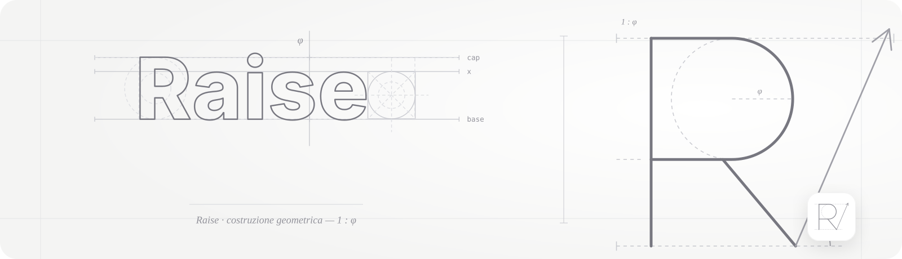
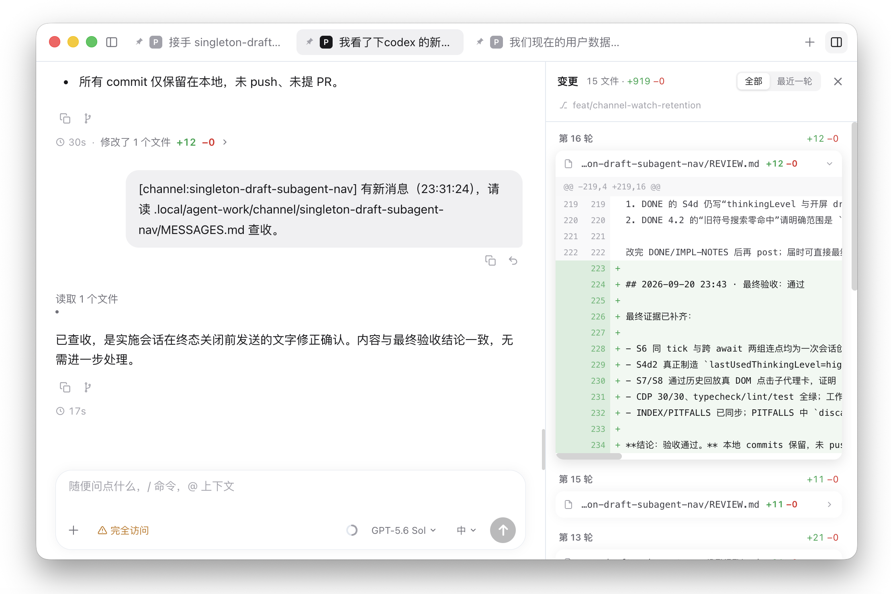
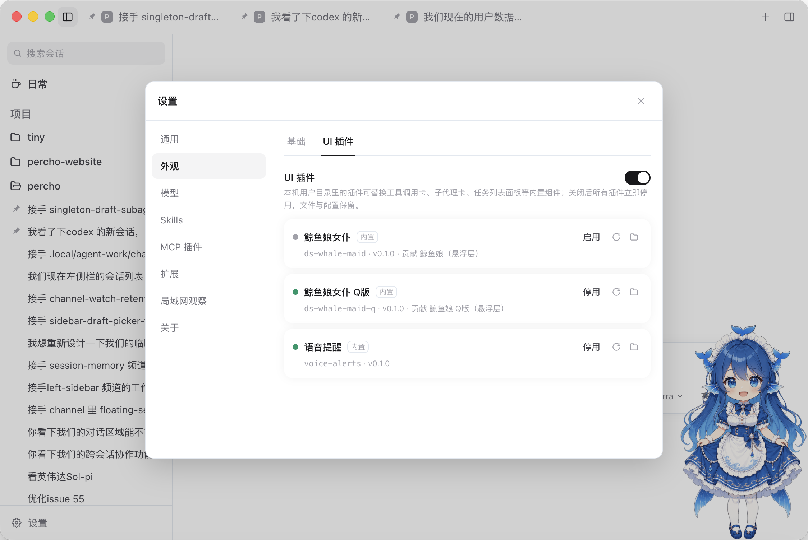
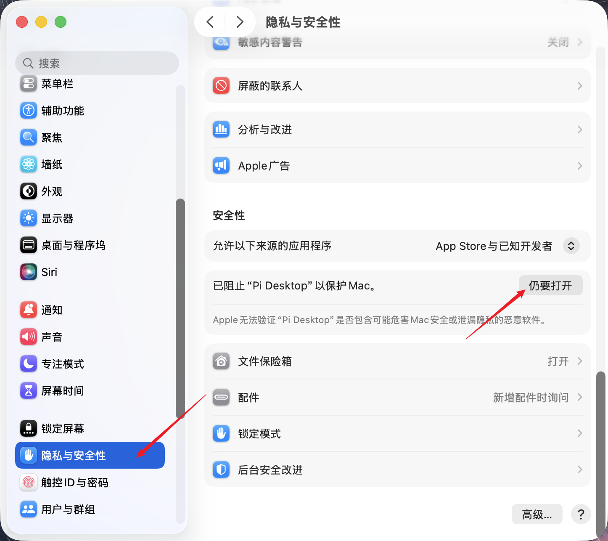

<p align="center">
  <picture>
    <source media="(prefers-color-scheme: dark)" srcset="docs/assets/img/readme-hero-dark.svg">
    
  </picture>
</p>
<h1 align="center">Raise</h1>
<p align="center">
  Highly customizable desktop GUI for the <a href="https://www.npmjs.com/package/@earendil-works/pi-coding-agent">Pi coding agent</a> — the same engine as the Pi CLI, in a clean visual interface. Multi-session chat, visual tool approvals, built-in subagents, UI plugins, and custom themes.
</p>
<p align="center">
  <a href="LICENSE"></a>
  <a href="https://gitee.com/zwxwrich/raise/badge/star"></a>
  <a href="https://gitee.com/zwxwrich/raise/badge/fork"></a>
  =22.19">
  
</p>
<p align="center">
  <a href="README.md">English</a> | <a href="README.zh.md">简体中文</a>
</p>

---

## Demo

<!-- Pending reshoot: chat_001 / chat_002 / demo-chat.gif / chat_img_bg_show_img.png all show a demo project
     named "percho" (and branch feat/channel-watch-retention), which drags the old brand name into a public README.
     When retaking, use a neutral project name (e.g. raise-demo) and a neutral branch name. -->





## Why Raise?

Raise embeds the official Pi SDK (`@earendil-works/pi-coding-agent`) in the Electron main process. It is **not a fork and not a reimplementation** — it runs the same engine as the Pi CLI and inherits Pi's native strengths:

- **Extensibility** — TypeScript extensions, skills, and prompt templates installed for the Pi CLI work here too, including project-local ones (with a trust prompt before loading). Adapt Pi to your workflows, no forking required.
- **Shared configuration** — same `~/.pi/agent/` directory as the CLI: sessions, auth, and model settings carry over. Start a session in the terminal, continue it in the GUI.
- **Providers** — subscriptions (Claude Pro/Max, ChatGPT Plus/Pro Codex, GitHub Copilot, logged in via an in-app OAuth flow) and API keys for Anthropic, OpenAI, Gemini, DeepSeek, Bedrock, and more; custom providers and base-URL overrides for relay gateways.

And for those who prefer a GUI over a TUI:

- Highly customizable UI — swap tool-call cards, drop in desk-pet overlays (two whale-maid pets ship built in), or extend the settings panel via UI plugins
- Visual permission gates — approve or deny each tool call from a dock, backed by a per-tool rule engine
- A collapsible project/session sidebar, draggable pinned-session pills, per-session composer drafts, and a follow-up queue with undo
- Built-in subagents — a scout plus your own agent definitions, parallel task fan-outs, and run cards you can click to inspect the sub-session read-only
- Context evaporation (on by default) — stale tool outputs age into compact stubs, keeping long sessions within budget
- Unified error system — in-chat error cards with one-click retry, an auto-retry status line, and full-page renderer crash recovery
- Solid session workspace — fork from assistant turns or selected context, recall your own message back into the composer, todo panel, per-turn diff sidebar, slash-command menu and @-file completion
- Streaming markdown rendering, image previews, message copy
- Agent-initiated image display — a built-in `show_image` tool lets the agent deliberately show you images inline (single or grouped), without turning every tool result into noise
- Custom background image with adjustable overlay dimming, light/dark/system themes
- Cross-device — monitor sessions from a phone or tablet browser via QR code; optionally enable remote prompts, stop generation, and allow-once/deny approval decisions

## Download

Installers are attached to **[GitHub Releases](https://github.com/zwxwrich/raise/releases/latest)** — Gitee caps a single release attachment at 100 MB, and these packages are larger, so the Gitee [release page](https://gitee.com/zwxwrich/raise/releases) carries the notes while the binaries live on GitHub. Links below always point at the newest release.

| Platform | Download |
| --- | --- |
| Windows (x64) | [raise-windows-x64.exe](https://github.com/zwxwrich/raise/releases/latest/download/raise-windows-x64.exe) (installer) · [raise-windows-x64.zip](https://github.com/zwxwrich/raise/releases/latest/download/raise-windows-x64.zip) (portable) |
| macOS (Apple Silicon) | [raise-mac-arm64.dmg](https://github.com/zwxwrich/raise/releases/latest/download/raise-mac-arm64.dmg) |
| macOS (Intel) | [raise-mac-x64.dmg](https://github.com/zwxwrich/raise/releases/latest/download/raise-mac-x64.dmg) |
| Linux (x64) | [raise-linux-x86_64.AppImage](https://github.com/zwxwrich/raise/releases/latest/download/raise-linux-x86_64.AppImage) |

> Builds are ad-hoc signed (no Developer ID certificate). On macOS, the first launch after a download may show **"Apple cannot verify Raise is free from malware"** — that's Gatekeeper blocking an un-notarized app. To open it:
>
> 1. **System Settings → Privacy & Security** → scroll to the bottom → click **Open Anyway** next to the Raise entry, then confirm with your password or Touch ID (recommended).
>
>    
>
> 2. Or in Terminal: `xattr -cr "/Applications/Raise.app"`.
>
> Updates ship as new release downloads: there is no in-app auto-updater in these builds (no update feed is configured), so grab the newest package from the link above when a new version is out. On Windows, click "More info" → "Run anyway" when SmartScreen appears.
>
> On Linux: make the AppImage executable before first launch (`chmod +x raise-linux-x86_64.AppImage`). On Ubuntu 22.04+/24.04+ and derivatives, install `libfuse2` first — AppImages mount via FUSE 2, which is no longer preinstalled.

## Development

Prerequisites: **Node.js >= 22.19**.

```bash
npm install
npm run dev
```

npm workspaces monorepo, three packages: `packages/shared` (IPC contracts), `packages/backend` (the only place that imports the Pi SDK), `packages/desktop` (Electron + React 19 + Tailwind 4 + Zustand). Common commands: `npm run typecheck` / `test` / `lint` / `build` / `dist`.

See [CONTRIBUTING.md](CONTRIBUTING.md) for the full guide. If you are in China and the Electron binary download stalls, set `ELECTRON_MIRROR=https://npmmirror.com/mirrors/electron/` first.

## Disclaimer

Raise is a community project. It is **not** built by or affiliated with the Pi team (earendil-works).

## License

[MIT](LICENSE)
